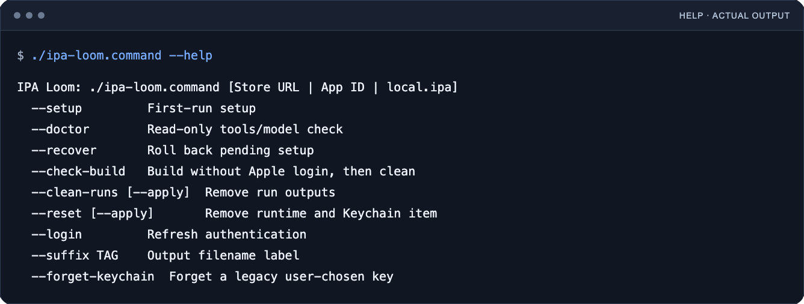
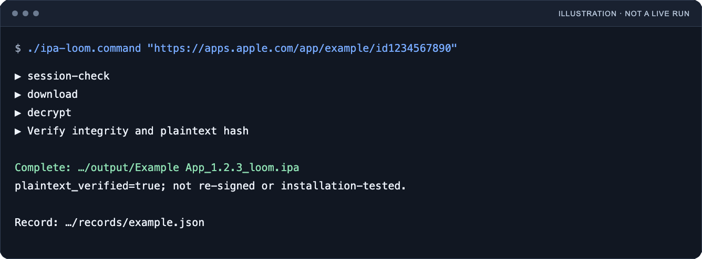

<p align="center">
  <picture>
    <source media="(prefers-color-scheme: dark)" srcset="docs/assets/logo/ipa-loom-lockup-on-dark.svg">
    
  </picture>
</p>

<h1 align="center">IPA Loom</h1>

<p align="center">
  <b>One local workflow, from App Store link to verified IPA.</b>
</p>

<p align="center">
  English · <a href="README.zh-TW.md">繁體中文</a>
</p>

---

## What it is

IPA Loom brings IPA download, decryption, verification, and cleanup together on an Apple Silicon Mac. Give it an App Store link, numeric App ID, or local IPA; one entry point guides setup and later runs. No jailbroken device is required.

It connects [ipatool](https://github.com/majd/ipatool) for Apple authentication and personalized downloads with [UnfairPlay](https://github.com/DrWhax/unfairplay) to recover the local enrollment model needed for decryption. Loom adds local credential storage, output naming, verification, recovery, and cleanup. It does not implement its own FairPlay decryption algorithm.

**Preview:** tool builds and the local workflow in an already configured environment have passed testing. The complete first-run flow, from Apple login and model setup through decryption, still needs independent testing on a Mac without IPA Loom installed. Not every app or macOS version is guaranteed to work.

## What it looks like

<p align="center">
  
</p>

Actual English `./ipa-loom.command --help` output, typeset for readability. Capturing it did not run setup or access an Apple account; the command-line interface and project documents use English.

<p align="center">
  
</p>

**Synthetic illustration, not a live run.** It shows the session check, download, decryption, verification and example output; no account, private model or real IPA was used. It does not establish successful first-run setup.

## Get started

Download and unzip the source, open its folder, and double-click `ipa-loom.command`. Or open a terminal in that folder:

```sh
./ipa-loom.command
```

You need an Apple Silicon Mac, network access for setup/downloads, and an Apple Account entitled to the app. Initial model setup also needs an installed, opened iPhone/iPad app from the Mac App Store and its matching IPA. Missing Apple Command Line Tools are offered through Apple's installer after you agree.

The wizard builds verified, pinned tools and guides Apple login, matching-app checks, model recovery, and verification. Apple password, 2FA, Keychain authorization, and the initial macOS administrator prompt are handled locally. The generated unlock key is saved in the local Keychain after successful setup. See [first-run setup](docs/SETUP.md) for requirements and prompts.

## Use it

Run the same command again and enter the target when asked. To process an existing IPA directly:

```sh
./ipa-loom.command "/path/to/Example.ipa" --suffix my-tag
```

Store targets check the session and download before decryption. Local IPA targets skip those two steps. Later runs reuse the configured model and Keychain item; renewed Apple authentication or Keychain access may still need your input. A Store link alone does not remove setup or account requirements.

Output uses `StoreName_Version_loom.ipa`. The Store name comes from IPA metadata, with app-name fallbacks when absent. `--suffix` changes only the filename label, not code signing. The terminal prints the output location.

## What success means

A passed run requires a complete plaintext-verification report, a matching output hash, valid ZIP contents, unchanged app identity/version, and no `SC_Info` files. A successful download or a zero exit code alone is not enough.

The output is **not re-signed**. Verification does not establish Apple signature trust, installability, or correct app behavior. Use only accounts, devices, and apps you are authorized to inspect; do not redistribute app packages or credentials.

## Your data

Tools, encrypted account state, the private model, caches, outputs, and records live outside the source folder under `~/Library/Application Support/IPA Loom/`. The Keychain stores a separate non-synchronizing unlock key. ipatool's encrypted state includes the Apple password and token; this data directory must stay private.

The test suite is maintained privately outside the source repository. No account, model, real IPA, or private test record ships with the source. Read [security and data handling](SECURITY.md) before sharing diagnostics.

## Recover or clean up

Setup prepares files in a temporary directory and activates the installation only after verification. Ordinary failures roll back that attempt; uncertain child termination or failed ownership restoration preserves staging for inspection. Use `./ipa-loom.command --recover` after an interrupted setup, or `--doctor` to check local readiness.

`--clean-runs` previews removal of run outputs and diagnostics while retaining setup and summaries. `--reset` previews removal of the private runtime and its Keychain item. Add `--apply` to perform the chosen cleanup. Save wanted outputs first. Apple developer tools, installed apps, Store login, and external backups are not removed. See [operations](docs/OPERATIONS.md).

## Documentation

- [Features](docs/FEATURES.md) · [Setup and prompts](docs/SETUP.md)
- [Recovery and cleanup](docs/OPERATIONS.md) · [Security](SECURITY.md)
- [Upstream components and licenses](docs/UPSTREAM.md) · [Update testing](docs/UPDATES.md)
- [Contributing and source checks](CONTRIBUTING.md) · [Release checklist](docs/RELEASING.md)

IPA Loom provides upstream update detection and separate build tests without automatically replacing installed tools. A new dependency must pass compatibility checks and maintainer testing with authorized accounts and apps before inclusion in a future release. See [release readiness](docs/RELEASE-READINESS.md) for verification still to be completed.

## License

Original integration code is [MIT](LICENSE). Upstream works retain their [licenses and notices](THIRD_PARTY_NOTICES.md). IPA Loom is independent of Apple and the upstream maintainers. Releases use date tags such as `v2026.11.9`, separate from dependency versions.

The IPA Loom logo is a V-AX brand asset, separate from the code license. See [brand usage](BRAND.md).
