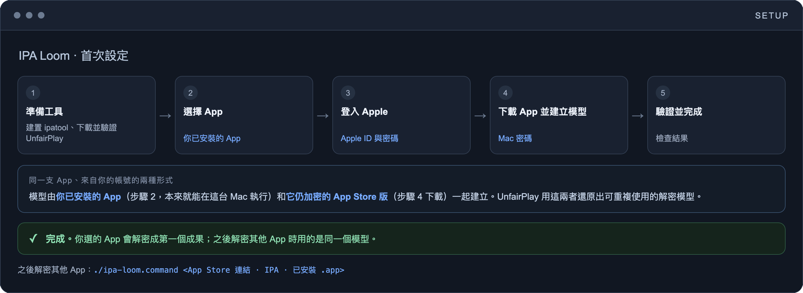
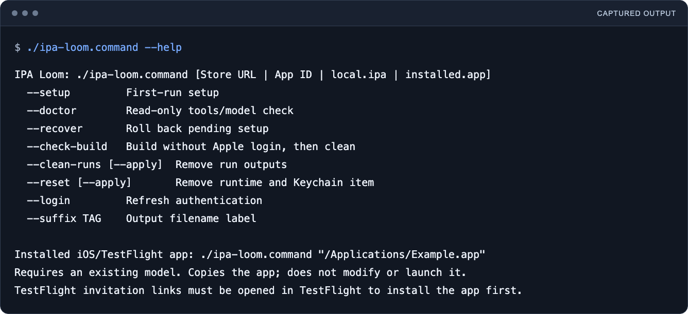
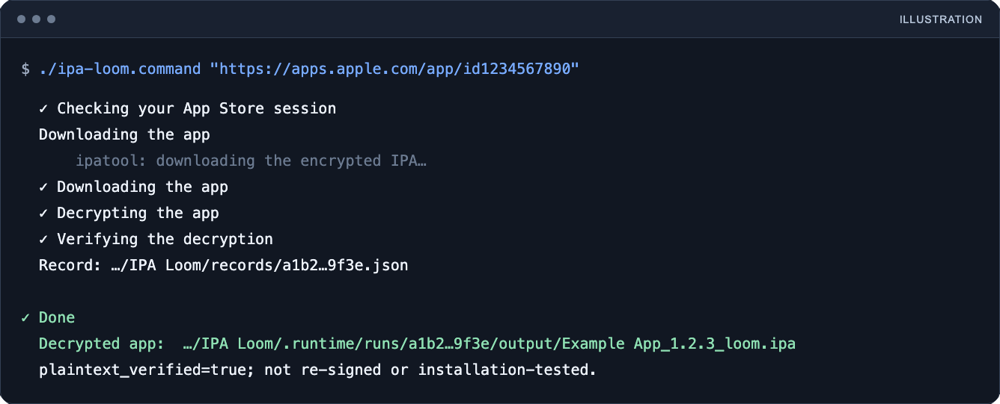

<p align="center">
  <picture>
    <source media="(prefers-color-scheme: dark)" srcset="docs/assets/logo/ipa-loom-lockup-on-dark.svg">
    
  </picture>
</p>

<h1 align="center">IPA Loom</h1>

<p align="center">
  <b>在 Apple Silicon Mac 下載、解密並驗證 IPA。</b><br>
  一套在本機執行的命令列流程，使用你自己的 Apple 帳號，不需越獄裝置。
</p>

<p align="center">
  <a href="README.md">English</a> · 繁體中文
</p>

## 這是什麼

IPA Loom 把 IPA 下載、解密、驗證與清理整合在一台 Apple Silicon Mac 上。給它 App Store 連結、數字 App ID、本機 IPA，或已安裝的 iOS `.app`；單一入口引導設定與之後的執行。

它串接 [ipatool](https://github.com/majd/ipatool)（Apple 認證與個人化下載）與 [UnfairPlay](https://github.com/DrWhax/unfairplay)（復原解密所需的本機 enrollment 模型）。Loom 另外負責本機憑證保存、輸出命名、驗證、復原與清理。它不自行實作 FairPlay 解密演算法，也不會把單純的 Store 連結變成免憑證下載。

## 功能

- 單一啟動器，涵蓋首次設定，以及之後的 Store 連結、App ID、本機 IPA 與已安裝 iOS App 執行。
- 用你的 Apple 帳號在本機登入；狀態解鎖金鑰留在你的鑰匙圈。
- 透過復原的裝置 enrollment 模型解密，不需越獄裝置。
- 首次設定也會把你選的那支 App 解密後留作第一個成果；之後解密其他 App 時用的是同一個模型。
- 驗證一次執行是否產生完整明文報告、相符雜湊、有效 ZIP 內容、未變的 App 識別，以及沒有 `SC_Info` 檔案。
- 可復原中斷的設定；清理前會先預覽再移除。

## 實際畫面

<p align="center">
  
</p>

首次設定如何建立可重複使用的解密模型：你已安裝的 App 本來就能在這台 Mac 上執行，它的 App Store 版還是加密的，UnfairPlay 用這一對還原出模型。

<p align="center">
  
</p>

實際的英文 `--help` 輸出，重新排版以利閱讀。執行 `./ipa-loom.command --help` 看目前完整清單。擷取時沒有執行設定，也沒有存取 Apple 帳號。

<p align="center">
  
</p>

**示意圖，不是實際執行。** 它顯示工作階段檢查、下載、解密、驗證與範例輸出；沒有用到任何帳號、私有模型或真實 IPA。

## 需求

- 一台 Apple Silicon Mac，並安裝 Apple Command Line Tools（缺少時由 Apple 的安裝程式提供）與 Python 3.9 以上。
- 設定與下載所需的網路連線。
- 一個有該 App 權利的 Apple 帳號。
- 首次模型設定還需要：一個已安裝並開啟過、來自 Mac App Store 的 iPhone 或 iPad App，以及對應的 IPA。

## 快速開始

下載並解壓原始碼，開啟資料夾，雙擊 `ipa-loom.command`。或在該資料夾開啟終端機：

```sh
./ipa-loom.command
```

首次使用會建置鎖定工具，並引導 Apple 登入、對應 App 檢查、模型復原與驗證。ipatool 由原始碼編譯；UnfairPlay 是以雜湊鎖定的預編執行檔，模型設定時以管理員權限（`sudo`）執行一次。Apple 密碼、2FA、鑰匙圈授權與 macOS 管理員提示都在本機處理。產生的解鎖金鑰在設定後存入你的鑰匙圈。設定結束時會把你選的那支 App 解密後留作第一個成果，並印出它的路徑。見[首次設定](docs/SETUP.md)。

## 使用方式

再次執行同一個指令並給它目標，可當參數或在提示輸入。App Store App 有三種方式可以解密：App Store 連結、數字 App ID，或（已安裝在這台 Mac 時）它的 `.app` 路徑。`.app` 路徑適用於已安裝的 iPhone／iPad App，不分來源，包含 TestFlight 測試版；既有 `.ipa` 也可以：

```sh
./ipa-loom.command "/path/to/Example.ipa" --suffix my-tag
```

Store 目標會在解密前檢查工作階段並下載。本機 IPA 與已安裝 App 目標略過這兩步。之後的執行沿用已設定的模型與鑰匙圈項目；重新進行 Apple 認證或鑰匙圈存取時仍可能需要你輸入。相對路徑會以啟動器所在資料夾為基準，所以本機 IPA 請用絕對路徑。

輸出檔名為 `StoreName_Version_loom.ipa`。Store 名稱取自 IPA 中繼資料，缺少時以 App 名稱備用。`--suffix` 只改檔名標籤，不改程式碼簽章。終端機會印出輸出位置。

### 已安裝的 App（App Store 或 TestFlight）

設定完成後，給一個已安裝的 iPhone 或 iPad App 的 `.app` 路徑即可。TestFlight 測試版無法下載，所以先在這台 Mac 用 TestFlight 安裝、再從它已安裝的 `.app` 解密，然後執行：

```sh
./ipa-loom.command "/Applications/Example.app" --suffix my-tag
```

你也可以在互動提示輸入 `.app` 路徑。Loom 讀取 Mac wrapper 內的 iOS bundle，複製成一份私有 IPA，對那份副本解密與驗證，並檢查來源 bundle 未變。它不會啟動、重新簽章或寫入已安裝的 App。若 TestFlight 在執行途中更新了 bundle，Loom 會判定失敗；等更新完成後重試。

這條路線需要既有且已驗證的模型；它不會從 TestFlight App 初始化模型。`https://testflight.apple.com/join/...` 或 `itms-beta://...` 連結開啟的是邀請，不是 IPA 下載：請先用 TestFlight 安裝測試版。原生 Mac App 與內含符號連結或特殊檔案的 iOS bundle 不支援。帳號與測試版軟體的風險請見下方[限制](#限制)。

## 成功的定義

一次通過的執行需要完整的明文驗證報告、相符的輸出雜湊、有效的 ZIP 內容、未變的 App 識別與版本，以及沒有 `SC_Info` 檔案。只有下載成功或結束代碼為零並不足夠。

## 你的資料

工具、加密的帳號狀態、私有模型、快取、輸出與紀錄都放在原始碼資料夾之外的 `~/Library/Application Support/IPA Loom/`。鑰匙圈另存一把不同步的解鎖金鑰。ipatool 的加密狀態含你的 Apple 密碼與權杖，所以這個資料夾必須保持私密。原始碼不附帶任何帳號、模型或真實 IPA。分享診斷前請先讀[安全](SECURITY.md)。

## 復原與清理

設定在暫存目錄準備檔案，驗證通過後才啟用安裝。一般失敗會回退；子程序結束不確定或還原擁有權失敗時，會保留暫存以便檢查。中斷的設定用 `./ipa-loom.command --recover`，或用 `--doctor` 檢查就緒狀態。

`--clean-runs` 預覽移除執行輸出與診斷，保留設定與摘要。`--reset` 預覽移除私有執行環境與其鑰匙圈項目。加 `--apply` 才真的執行。先存下想保留的輸出。Apple 開發者工具、已安裝的 App、Mac App Store 的登入與外部備份不會被移除。見[操作](docs/OPERATIONS.md)。

## 限制

- **預覽版。** 工具建置與在已設定好的 Mac 上的本機流程已通過測試。完整的首次流程，從 Apple 登入、模型設定到解密，仍需在一台未安裝 IPA Loom 的 Mac 上獨立測試。不保證每個 App 或每個 macOS 版本都能成功。
- **它會移除 FairPlay 保護。** IPA Loom 會寫出該 App 的解密 IPA。輸出**未重新簽章**；通過驗證不等於 Apple 簽章信任、可安裝、行為正確，或可以轉散布。
- **它會用你的 Apple 帳號**，透過非官方用戶端 ipatool。Apple 可能要求額外驗證，或限制這樣使用的帳號。
- **它不檢查歸屬。** 本機 IPA 或已安裝 App 不會檢查是否屬於登入的帳號，這交給 Apple 與模型。只檢視你有權檢視的 App。
- **TestFlight 測試版**是測試軟體，受開發者與 Apple 的 TestFlight 條款約束，常是保密的，而且不檢查你的資格。
- **它會連網**，在設定與下載時連到（包含但不限於）`go.dev`、`api.github.com`、`github.com`、它們轉址的主機、Go 的模組代理與雜湊資料庫，以及 Apple（登入、下載與框架下載）。見[安全](SECURITY.md)。

## 文件

- [功能](docs/FEATURES.md) · [設定與提示](docs/SETUP.md)
- [復原與清理](docs/OPERATIONS.md) · [更新測試](docs/UPDATES.md)
- [上游元件與授權](docs/UPSTREAM.md)

## 安全

IPA Loom 在本機處理你的 Apple 憑證、enrollment 模型與解密後的 App 套件。見 [SECURITY.md](SECURITY.md) 了解它預期怎麼執行、有哪些風險，以及如何回報漏洞。

## 參與貢獻

歡迎開 issue 與小而聚焦的 pull request。見 [CONTRIBUTING.md](CONTRIBUTING.md)。

## 授權

程式碼以 [MIT License](LICENSE) 釋出。標誌不在此授權內，見 [BRAND.md](BRAND.md)。

第三方元件保留各自的授權，見 [THIRD_PARTY_NOTICES.md](THIRD_PARTY_NOTICES.md)。

IPA Loom 是獨立專案，並非由 Apple 製作，也與其沒有關係或背書。Apple 是 Apple Inc. 的商標。

由 [V-AX](https://v-ax.com) 製作。
