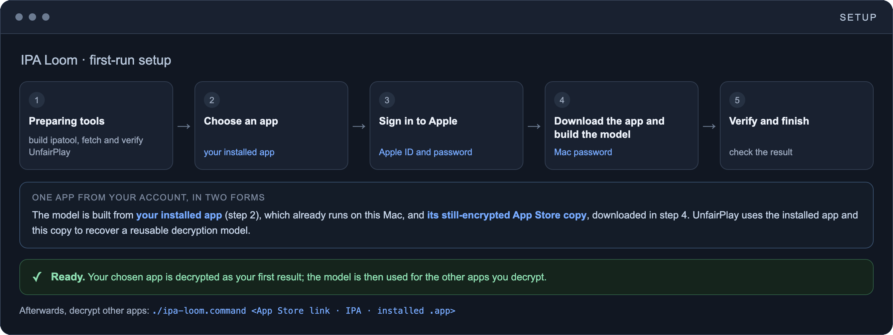

# First-run setup

  

Double-click `ipa-loom.command`, or run `./ipa-loom.command --setup`. `--help` and malformed options are handled before system-tool checks. The launcher checks Apple Silicon macOS and offers Apple's Command Line Tools installer only after consent. If that installer is cancelled or incomplete, setup stops. It is an OS installation and is not rolled back by Loom.

## Before you start

1. Use an Apple Silicon Mac and an Apple Account that can obtain the selected app. The complete setup flow still needs testing on a Mac without IPA Loom installed; support for every macOS release is not established.
2. Install an iPhone/iPad app from the Mac App Store ("iPhone & iPad Apps" tab) with that account, open it once, and update it to its current version. A Mac-only app and a TestFlight beta are not valid setup inputs.
3. In step 2 of 5 (Choose an app) setup lists the installed Mac App Store apps it finds; enter the number of one and it fills in the matching App Store link, or type an installed `.app` path (an App Store app, not a Mac app or a TestFlight beta). The app must be at its current App Store version so its bundle ID, version, and build match the download. An entry that cannot be used asks again, and a local IPA for a different app or version is rejected at the prompt. A link for a different app or version is only found after the download and ends setup, as does a download that fails; it says which, so update the app or pick the matching one and run `--setup` again.
4. Run `./ipa-loom.command`. Follow the local terminal prompts; never paste credentials or raw reports into an issue.

Running a target before setup (for example `./ipa-loom.command "https://apps.apple.com/app/id000"`) runs setup first with an app you pick from the list. If that target is the same app, by App Store link or ID, it is not decrypted again; a different app, or a local IPA even of the same app, is decrypted as a normal run afterwards. Setup runs as five numbered phases, and the steps that ask you for something are marked. Because it already decrypts the app you chose to verify the model, it keeps that decrypted IPA as your first result under `.runtime/runs/` in your private data directory and prints its path when it finishes; `--clean-runs` removes saved run outputs, including this one. Decrypt more apps any time with `./ipa-loom.command <App Store link, IPA path, or installed .app>`.

Installed TestFlight `.app` targets are for later runs with a verified model. They cannot replace the matching Store URL/IPA in this setup wizard. If passed before setup is ready, Loom stops with setup guidance rather than downloading or attempting recovery from the TestFlight app.

## Prompts and later runs

| Prompt | Why | Later use |
|---|---|---|
| Apple Account password / 2FA | ipatool authentication | Usually reused from encrypted state; Apple may require renewal |
| macOS administrator password | Initial UnfairPlay model recovery | Ordinary configured dump runs do not repeat model setup |
| Keychain access | Store/read the separate file-keyring unlock key | macOS may ask again if access is locked or permissions change |

The administrator password is not stored by Loom. It does not store the Apple password directly in Keychain: ipatool stores the Apple password/token in encrypted files, and Keychain holds their separate unlock key. If Apple or macOS requests authorization, you must respond locally before the workflow can continue.

Preparation can take time before a verification-code prompt appears. Follow the current stage output; do not start a second copy while the first is working. A build-only check validates tools, not Apple login or model recovery.

## How setup prepares and activates the installation

1. Require an interactive terminal for first-time account/model initialization before downloading anything. Create a private data directory outside the source tree, mark it as managed by Loom, and acquire the lock shared by setup and routine runs.
2. Recover any interrupted setup attempt. If a recorded child process may still be running, stop recovery; leave an already configured installation intact.
3. Download the exact Go, ipatool source, and UnfairPlay archive in `config/dependencies.json`; verify SHA256 before extraction. Archives with links or traversal paths are rejected.
4. Check/apply the pinned patch and build ipatool plus the Swift bridge. Go module/build/telemetry and Clang/Swift caches stay inside staging. The pinned Go telemetry override is checked against `go env`, and mode must be off. User curl configuration is disabled.
5. Ask for an installed/opened iPhone/iPad app and its matching Store URL or local IPA. Log in to the same Apple Account in the terminal. A random file-keyring key is passed over a pipe, never argv or an environment value.
6. Download/copy the IPA without a purchase flag. Require exact bundle ID, version, and build agreement with the installed app before sudo setup.
7. Recover the model using UnfairPlay, restore user ownership, decrypt as the ordinary user, and verify the result.
8. Save the unlock key to a new non-synchronizing Keychain item, then atomically rename the completed runtime into place. No existing runtime is overwritten.
9. Once child termination and file ownership are confirmed, delete build tools, archives, source, module caches, and setup IPA copies. Uncertain termination or failed ownership restoration retains staging for inspection. Keep a summary; failed attempts retain only the last private diagnostic logs after rollback.

Apple credentials, 2FA, sudo, and any Keychain access dialog require the person at the Mac. The workflow does not bypass these prompts or import somebody else's model. A new setup has no user-chosen file passphrase to remember.

## Where private data is stored

The default root is `~/Library/Application Support/IPA Loom/`. An explicit absolute `IPA_LOOM_DATA_HOME` can select an isolated root; it must not be inside/above the source checkout, be a symlink, or be an unrelated existing directory. The root is owner-only and carries a Loom marker.

- `.local/bin`: verified tools and the bridge.
- `.local/tools.json`: hashes, initialization state, and Keychain scope.
- `.local/state/ipatool`: encrypted Apple credentials and tokens.
- `.local/cache/ipatool`: reusable authentication/runtime assets.
- `.local/models`: private enrollment model.
- `.setup`: a pending transaction only; `setup.json` is its private summary.
- `.runtime/runs`: private outputs and logs; `records` holds summaries.
- `diagnostics/last-setup`: only the last failed setup's private logs, when available.

`./ipa-loom.command --check-build` runs downloads, build, tool-version and CLI-contract checks without Apple login, sudo model recovery, or Keychain operations, then removes staging. It stops rather than replacing an existing installation.
