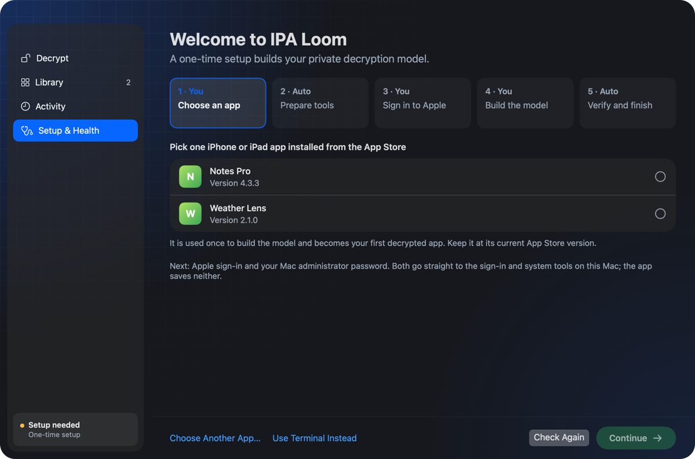
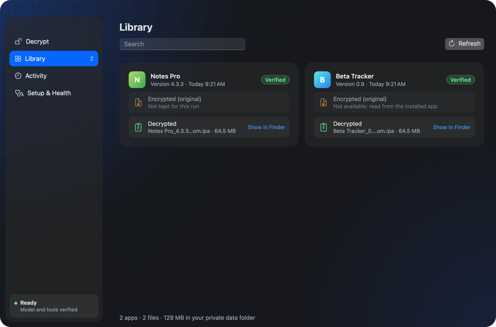

# IPA Loom for Mac

Install with `brew install --cask xxxxDev/tap/ipa-loom`, or download the disk image from the [latest release](https://github.com/xxxxDev/ipa-loom/releases/latest). The rest of this page is for building it yourself.

A native window over the same engine the terminal command runs. It starts the engine, reads the records the engine writes, and shows your decrypted apps. It holds no account, model or IPA of its own: everything stays in the private data folder (`~/Library/Application Support/IPA Loom`), shared with `ipa-loom.command`.

<p align="center">
  
</p>
<p align="center">
  
</p>

The pictures show sample data, drawn by the app itself with fictional apps; no account, model or real IPA was used.

The app is dark only and uses Liquid Glass on macOS 26 and later, with a plain material on macOS 14 and 15.

## Build

From the repository root, double-click `ipa-loom-app.command`, or run:

```sh
mac/build-app.sh
open "mac/build/IPA Loom.app"
```

Apple's Command Line Tools are enough; Xcode is not needed. The build copies the engine (`scripts`, `config`, `patches`, `native`, `licenses`) into the app, so the app keeps working if this folder moves. The signature is ad hoc by default: made on this Mac, for this Mac. A release build is signed with the project's own self-signed certificate when `mac/signing.env` (kept out of git) names one; the variables are listed at the top of `mac/build-app.sh`. It is not a Developer ID and the app is not notarized.

## What it does today

| Page | What it shows |
| --- | --- |
| Decrypt | Paste an App Store link or App ID, or drop an `.ipa` or an installed `.app`. Shows the run's steps and files, and can cancel it. |
| Library | Every decrypted app still on disk, with its files and a Show in Finder link. |
| Activity | Every run the engine has recorded. |
| Setup & Health | Whether the engine is ready, where your private data is, and whether a newer release is out. |

An App Store run started from the app also keeps the encrypted download (`--keep-encrypted`), so the Library shows both files. Earlier runs, local files and installed apps have no kept original.

First-time setup runs in the app, from Setup & Health: pick the installed app, then answer the Apple sign-in and the Mac administrator password in the app's own forms. The engine's sign-in and system tools still do the asking, on a private terminal the app stands in front of (`scripts/terminal_bridge.py`); the app passes on what you type and saves none of it. The same setup in Terminal stays available.

## Updates

The app looks for a newer release once a day, and when you choose Check for Updates in the IPA Loom menu. It asks GitHub for the public list of this project's releases and sends nothing about you or your apps. The daily check can be switched off in Setup & Health.

Nothing is downloaded until you choose Install and Restart. The app then downloads the release's disk image and installs it only if every check passes: the image matches the SHA-256 GitHub records for it, and the app inside is signed with the same certificate as the one running and is the version offered. The new app and the old one change places in one step, so there is never a moment without an app, and IPA Loom then restarts. It will not install while a decryption or setup is running.

A copy that cannot do this safely does not try: a build signed ad hoc (which is what `mac/build-app.sh` makes without a certificate), one macOS runs from a temporary place, one in a folder it cannot write or that other accounts can change, or one on another disk than your home folder. It shows the release page and the Homebrew command instead.

An update replaces only the app. Your setup, model and Library stay in the private data folder.

## Release image

```sh
mac/build-app.sh && mac/make-dmg.sh
```

`make-dmg.sh` packs the built app into `mac/build/IPA-Loom-<version>-arm64.dmg` and prints its SHA-256. The image is not signed or notarized, so a downloaded copy needs Open Anyway in System Settings on first launch. A fork sets `IPA_LOOM_REPOSITORY=owner/name` when building so its app looks at its own releases.

## Layout

```
mac/
  Package.swift           Swift package, one executable target
  build-app.sh            builds and signs "IPA Loom.app" into mac/build/
  make-dmg.sh             packs the built app into a disk image for a release
  AppIcon.svg             icon source; Resources/AppIcon.icns is made from it
  Sources/IPALoom/
    IPALoomApp.swift      entry point, window and menus
    AppModel.swift        app state and the running session
    Engine.swift          starts the engine and reads its records
    Look.swift            colours, glass, backdrop and shared pieces
    RootView.swift        sidebar and page frame
    DecryptPage.swift     link field, drop area and the run view
    LibraryPage.swift     Library and Activity
    HealthPage.swift      Setup & Health
    Update.swift          looks for a newer release
    UpdateInstall.swift   downloads, checks and installs one
    Snapshot.swift        debug only: draws each page to a PNG file
```

## Check the layout without opening a window

A debug build can draw every page to PNG files with sample data. It does not start the engine or read your private data.

```sh
cd mac && swift build
IPA_LOOM_APP_SNAPSHOT=/tmp/ipa-loom-pages .build/debug/IPALoom
```

The pictures show the layout, not the glass, which the window server adds.
